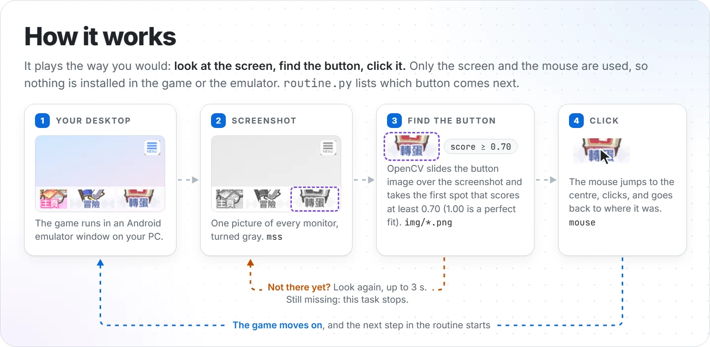
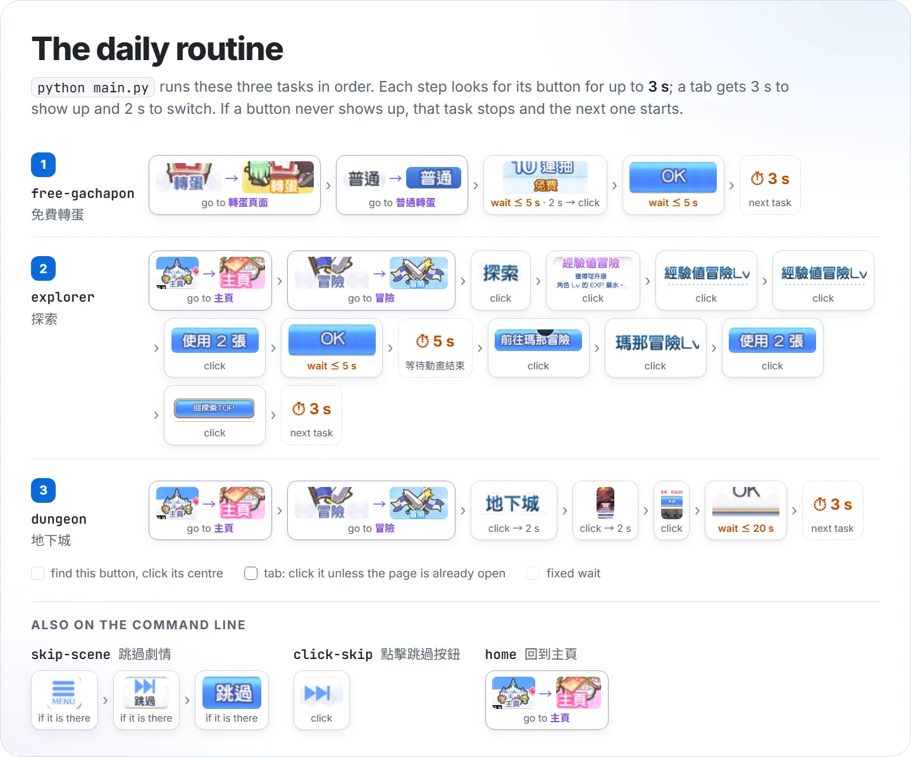

> [!NOTE]
> **This script is no longer needed.** Princess Connect! Re:Dive added a schedule book, 予定帳, that
> does these chores itself: exploration, the normal gacha, dungeons and more, in one go. It arrived in the
> Japanese version on 2022-10-28 ([GameWith's guide to 予定帳](https://gamewith.jp/pricone-re/article/show/370251)).
> The repo stays up for reference and is not maintained.
>
> 已經不需要這個腳本了：遊戲加入了「予定帳」，探索、普通轉蛋、地下城等日常任務可以一次完成（日版 2022-10-28 加入）。這個 repo 只留作參考，不再維護。

# 公主連結 Re:Dive 日常任務自動腳本

**PCR Auto Daily Routine**

<p>
  <a href="https://github.com/NatLee/pcr-auto-daily-routine/actions/workflows/test.yml"></a>
  
  
  <a href="LICENSE"></a>
</p>

A small Windows script that did the daily chores of Princess Connect! Re:Dive (the Traditional Chinese
version) for you: the free normal 10-pull, two exploration runs (EXP and mana), and skipping the
EXTREME V dungeon. The game runs in an Android emulator window; the script looks at the screen, finds
each button by comparing it with small pictures of that button, and clicks it with the mouse, the way you
would. It never touches the game or the emulator itself.

## How it works

<picture>
  <source media="(prefers-color-scheme: dark)" srcset="docs/images/how-it-works-dark.webp">
  
</picture>

Every step of a task goes around this loop:

1. **Screenshot.** [mss](https://github.com/BoboTiG/python-mss) grabs every monitor as one picture, and
   it is turned gray.
2. **Find the button.** OpenCV's template matching slides the button picture from [`img/`](img/) over
   the screenshot and scores each spot (1.0 is a perfect fit). The first spot scoring 0.7 or more, reading
   from the top, is the button.
3. **Click.** The [mouse](https://github.com/boppreh/mouse) package moves the cursor to the button's
   centre, clicks, and puts the cursor back.

If the button is not there yet, it takes another screenshot, for up to 3 seconds (some steps wait longer).
If it never shows up, that task stops and the next task starts.

## The daily routine

<picture>
  <source media="(prefers-color-scheme: dark)" srcset="docs/images/daily-routine-dark.webp">
  
</picture>

A purple step is a tab: the script clicks it unless the page is already open, then checks that the page
did open. The picture is drawn from [`pcr_routine/routine.py`](pcr_routine/routine.py), so it shows
exactly what the code does.

## Requirements

- **Windows** and **Python 3.9 or newer.** The script was written for and used on Windows. The tests also
  run on Linux, but clicking there needs root (a limit of the mouse package), and nobody has tried it.
- **The game in an Android emulator window**, in Traditional Chinese, fully visible on one of your
  monitors. Several monitors are fine.
- **The same window size as when the button pictures were taken.** Matching compares pixels at their
  original size, so a bigger or smaller window means no match. If yours differs, capture your own
  buttons into `img/` with the same file names.

## Install

```bash
git clone https://github.com/NatLee/pcr-auto-daily-routine.git
cd pcr-auto-daily-routine
pip install -r requirements.txt
```

## Usage

Open the game, then:

```bash
python main.py                  # the daily routine: free-gachapon, explorer, dungeon
python main.py skip-scene       # just skip the story scene on screen
python main.py home dungeon     # any tasks, in the order you give them
```

Keep your hands off the mouse while it runs: each click moves the cursor. `python main.py --help` lists
the tasks:

```text
usage: main.py [-h] [TASK ...]

Play the daily chores of Princess Connect! Re:Dive in an emulator window: it looks at the screen and clicks the buttons it finds.

positional arguments:
  TASK        tasks to run, in this order

options:
  -h, --help  show this help message and exit

tasks:
  free-gachapon  免費轉蛋
  explorer       探索
  dungeon        地下城
  skip-scene     跳過劇情
  click-skip     點擊跳過按鈕
  home           回到主頁

With no TASK it runs: free-gachapon explorer dungeon
Exit status: 0 if every task finished, 1 if one stopped early or setup failed, 2 for a bad command line.
```

A task that stops early (say, the free 10-pull was already used today) does not stop the others. The log
says what it waited for, what it clicked and what it could not find, and ends with one line per task.
Here is a run where the free 10-pull was already used, played on the tests' pretend game (time stamps
left out):

```text
==== 執行免費轉蛋（free-gachapon）
前往轉蛋頁面
等待 gachapon-before.png（最多 3 秒）
找到 gachapon-before.png（0.2 秒）
已點擊轉蛋頁面
等待 gachapon-after.png（最多 2 秒）
找到 gachapon-after.png（0.2 秒）
已經在轉蛋頁面
…
等待 gachapon-10-free.png（最多 5 秒）
等不到 gachapon-10-free.png（5.2 秒）
找不到或是已使用過免費轉蛋
==== 執行探索（explorer）
…
free-gachapon：沒有完成
explorer：完成
dungeon：完成
```

If a button picture is missing, or the screen cannot be captured, it says so before clicking anything,
for example `main.py: error: Button image not found: …\img\OK.png`.

## Settings

The general knobs are in [`pcr_routine/config.py`](pcr_routine/config.py):

| Setting | Default | What it does |
|---|---|---|
| `image_dir` | `img/` next to the code | where the button pictures are |
| `match_threshold` | `0.7` | how similar a spot must be to count as the button (1.0 = identical) |
| `monitor` | `0` | which screen to capture: 0 = all monitors, 1 = the first, 2 = the second, … |
| `wait_timeout` | `3` s | how long a step looks for its button |
| `switch_before_timeout` | `3` s | how long a tab step looks for the tab |
| `switch_after_timeout` | `2` s | how long a tab step waits for the page to open |

The routine itself is in [`pcr_routine/routine.py`](pcr_routine/routine.py): each task is a list of steps,
and a step names its button picture and, if it needs one, its own wait. For example, the dungeon result
gets 20 seconds. To run a different dungeon, replace `img/adventure-dungeon-extreme-v.png` with a capture
of the one you want.

<details>
<summary>Project layout</summary>

| Path | What is in it |
|---|---|
| `main.py` | the command line entry point |
| `pcr_routine/config.py` | the settings above |
| `pcr_routine/routine.py` | every task, step by step |
| `pcr_routine/bot.py` | the step types (click, tab, pause) and the wait-and-click logic |
| `pcr_routine/vision.py` | loading button pictures and finding them on a screenshot |
| `pcr_routine/device.py` | the only code that touches the real screen and mouse |
| `img/` | the button pictures, cropped from the game |
| `tests/` | tests that play every task on a pretend game, no emulator needed |
| `docs/images/` | the pictures in this README, and their HTML sources in `src/` |

</details>

## Demo

Recorded in January 2023 with an earlier version of the script.

- Skip a story scene

  

- Free gachapon and exploration

  https://user-images.githubusercontent.com/10178964/212544864-ae07be60-99c3-4507-95f8-79d88aabb494.mp4

- When the exploration was already done today, there is nothing to skip and the task stops

  https://user-images.githubusercontent.com/10178964/212544752-3eae06cb-2cac-4a08-9cab-1574b57d858b.mp4

The 予定帳 that made this script unnecessary (Japanese version):


Looking for a more complete script? Have a look at [Gibberer/pcr-script](https://github.com/Gibberer/pcr-script).

## Development

The tests build pretend game screens from the button pictures in `img/` and a pretend mouse, so they run
anywhere, without the game or a screen:

```bash
pip install -r requirements-dev.txt
python -m pytest
ruff check .
```

The README pictures are drawn from the routine. After changing `routine.py` or `config.py`, run
`python docs/images/src/export_routine.py` (a test fails until you do), then render the HTML files in
[`docs/images/src/`](docs/images/src/) again as described at the top of each one.

## Credits and license

Princess Connect! Re:Dive is a game by Cygames. The button pictures in `img/` and in the diagrams are
cropped from the game's screen and belong to their owners. This project is not affiliated with Cygames or
the game's publishers.

The code is under the [MIT License](LICENSE).
